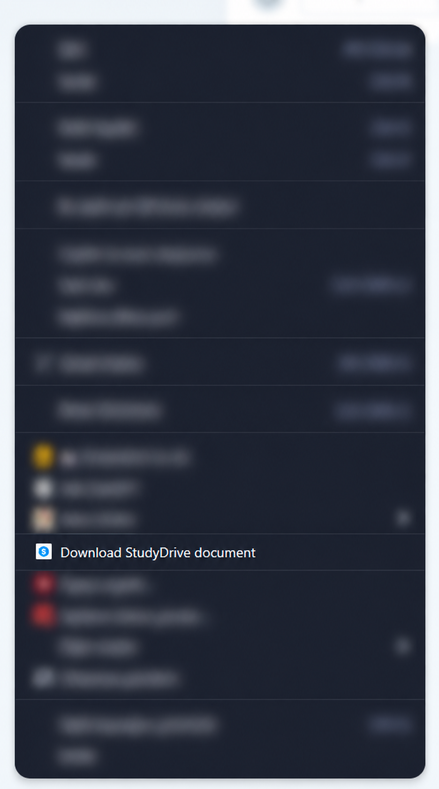

# StudyDrive Downloader Extension

Download a StudyDrive document's available PDF preview from the browser's right-click menu or the extension's toolbar icon. This fork replaces the injected page button with browser controls, so it no longer recreates a button that the website removes.

## Installation

1. On [this repository](https://github.com/Meminn/StudyDrive-Downloader-Extension), select **Code → Download ZIP** and extract the archive.
2. Open `edge://extensions` in Microsoft Edge or `chrome://extensions` in Google Chrome.
3. Enable **Developer mode**.
4. Select **Load unpacked** and choose the extracted folder containing `manifest.json`.

The right-click download flow has been manually verified in Microsoft Edge. This version has not been manually tested in Chrome.

## Download a document

1. Open a StudyDrive document page, such as `https://www.studydrive.net/en/doc/...`.
2. Right-click the page and select **Download StudyDrive document**. If the PDF viewer shows its own menu, right-click outside the viewer.
3. Alternatively, click the extension's icon in the browser toolbar. You can pin it from the browser's Extensions menu.



*Unrelated menu entries are obscured in this edited screenshot.*

There is no floating page button, automatic download, or button-recreation loop. Both browser controls run the same downloader when clicked.

## Updating an existing installation

Replace the extension files, click **Reload** on its card in `edge://extensions` or `chrome://extensions`, then close the old StudyDrive tab and open the document in a new tab. This clears stale extension contexts left behind by earlier versions.

## Limitations and errors

- The downloader still uses the `file_preview` link exposed in the document page's HTML. If that field is missing or the request fails, it displays an error; switching to a context menu does not change which files are available.
- PDF previews are supported. A `.docx` filename is saved with a `.pdf` extension for its PDF preview; other filename extensions are rejected.
- If the toolbar icon shows **ERR**, hover over it for the error message. Make sure the active tab is a StudyDrive document page.

## Permissions

- `activeTab`: temporary access to the tab when you invoke the downloader.
- `contextMenus`: adds the right-click download item.
- `scripting`: runs the downloader in the selected document tab on demand.

No persistent host access or third-party dependencies are required. The legacy popup files are retained but are no longer used.

## Development

No build step is required. Basic syntax checks:

```sh
node --check background.js
node --check content.js
```

After changing files, reload the unpacked extension and test in a fresh document tab.

Based on [Hamidchkms/StudyDrive-Downloader-Extension](https://github.com/Hamidchkms/StudyDrive-Downloader-Extension).
